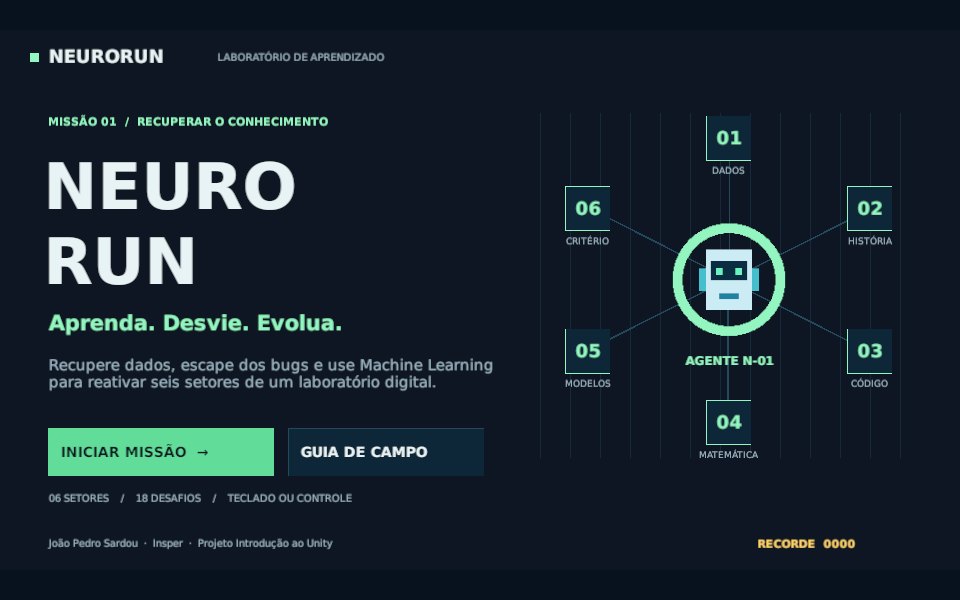

# NeuroRun

**Plantão no laboratório.** Um jogo de labirinto em Unity, com perseguição, coleta e perguntas de Machine Learning. Projeto Introdução ao Unity — Insper.

**Aluno:** João Pedro Sardou · Engenharia de Computação  
**Código:** https://github.com/jotasardou/Sardelas  
**Teste no itch.io (rascunho, exige a conta do autor):** https://jotasardou.itch.io/neurorun  
**Game Jam:** https://itch.io/jam/projeto-intro-unity-insper-20262

## Como jogar

O laboratório fechou, mas os bugs continuam soltos. Para acessar o terminal de cada andar:

1. Pegue os **seis disquetes** espalhados pelo labirinto.
2. Colete a cota de pontos de rede indicada na lateral: **125 no primeiro andar**, 65% dos pontos disponíveis em cada mapa.
3. Volte ao computador no centro. Só então o quiz abre.
4. Acerte três perguntas para passar ao próximo andar. São seis andares e 18 perguntas.

O movimento é contínuo, como num fliperama de labirinto: depois de sair, o personagem segue andando. **Aperte a direção antes da esquina** para guardar a curva. É possível inverter o sentido imediatamente.

### Pressão e recursos

- **Três a cinco bugs** buscam caminhos pelos corredores. Um segue o jogador, outro antecipa curvas e os outros tentam cercar. Alternam perseguição com breves períodos de patrulha.
- **Alarme:** ao pegar o quinto disquete, ou quando restam 25 segundos, os bugs aceleram e deixam de patrulhar.
- **Dash:** acelera por 0,22s e protege do contato; recarga de **4 segundos**.
- **Dois cafés por andar:** param os bugs e impedem dano por **4 segundos**. Não reaparecem após uma colisão.
- **Três vidas:** cada contato tira uma vida e **6 segundos**. Você volta à saída com 2s de proteção, os inimigos voltam às posições iniciais e os itens coletados ficam salvos.
- O primeiro andar começa com **95 segundos**; os seguintes têm 92, 89, 86, 83 e 80 segundos. Cada disquete acrescenta **2 segundos e 100 pontos**. Pontos pequenos valem 5; café vale 50.
- O quiz pausa o relógio durante a leitura. Erros custam **8 segundos**, mostram uma explicação e permitem nova tentativa. Acertar de primeira vale 120 pontos; após um erro, 70. O tempo restante vira bônus de 2 pontos por segundo inteiro.
- Derrota permite reiniciar o andar. O reinício restaura itens/vidas/tempo e o score do começo do andar; o tempo total conserva as tentativas anteriores. O recorde desta versão é separado do recorde da versão inicial.

| Ação | Teclado e mouse | Controle Xbox / compatível |
| --- | --- | --- |
| Escolher direção | WASD ou setas | Analógico esquerdo ou direcional |
| Dash | Espaço ou Shift esquerdo | B |
| Pausar / retomar | Esc | Start |
| Escolher resposta | 1, 2, 3 ou clique | Direcional e A |
| Navegar nos menus | Mouse ou Tab e Enter | Direcional e A |
| Som | Botão SOM / MUDO | Mouse no botão |

**Plataforma:** navegador desktop, WebGL. Celulares e controles físicos específicos não foram validados. O controle foi exercitado com um dispositivo virtual do Unity Input System; confira com um controle físico antes da apresentação.

## Conteúdo dos setores

| Setor | O que ensina |
| --- | --- |
| Dados e decisões | Aprendizado supervisionado, regressão e motivações para ML |
| Ideias que conectam | Alan Turing, Frank Rosenblatt e conexionismo |
| Do dado ao código | NumPy, scikit-learn, `fit` e separação de treino/teste |
| A matemática por trás | Média, gradiente e interpretação de probabilidades |
| Além da memorização | Overfitting, acurácia em dados desbalanceados e vazamento |
| Inteligência com critério | Viés, correlação/causalidade e aprendizado por reforço |

O jogo ensina conceitos introdutórios; não treina um modelo real nem executa Python. As explicações são parte da mecânica, e o guia de campo permite revisar as ideias antes da missão.

## Abrir na Unity

- Versão usada: **Unity 6000.6.6f1**, template Universal 2D.
- Adicione esta pasta ao Unity Hub e abra `Assets/NeuroRun/Scenes/NeuroRun.unity`.
- Pressione Play. O menu inicial abre automaticamente.
- A cena `Assets/Scenes/SampleScene.unity` conserva o trabalho inicial do tutorial.
- Os prefabs de jogador, inimigo e dado estão em `Assets/NeuroRun/Prefabs`.

O jogo usa Rigidbody2D, colliders, triggers, prefabs, scripts MonoBehaviour, Canvas, áudio e Input System. A arena e a UI são montadas em C# no início da partida para reutilizar o mesmo layout entre os seis setores. O menu `NeuroRun > Criar cena do jogo` é uma ferramenta opcional de reconstrução: use-o apenas quando quiser recriar a cena a partir do código.

## Organização do código

| Arquivo | Responsabilidade |
| --- | --- |
| `NeuroRunGame.cs` | Estados, tempo, score, vida, perguntas e progressão |
| `RunnerController.cs` | Movimentação, dash, invulnerabilidade e colisões |
| `BugEnemy.cs` | Patrulha e perseguição variável |
| `DataPickup.cs` | Coleta por trigger, com proteção contra contagem duplicada |
| `MazeGrid.cs` | Mapa de corredores e busca em largura para perseguidores |
| `ArenaFactory.cs` | Montagem das paredes, disquetes, cafés e pontos |
| `LessonData.cs` | 18 perguntas, alternativas e explicações |
| `NeuroUI.cs` | Menu, HUD, guia, perguntas e telas de resultado |
| `NeuroAudio.cs` | Música, efeitos e opção de silenciar |
| `Editor/NeuroRunBuilder.cs` | Geração de sprites, prefabs, cena e configuração WebGL |
| `Tools/generate_audio.py` | Geração original de música e efeitos WAV |
| `Tools/ValidateGame.cs` | Teste de integração, executado somente no Editor via CLI |

Os scripts têm comentários em português e usam estados explícitos para bloquear movimento durante menus e leitura. O personagem e os inimigos se movem em `FixedUpdate`, enquanto UI e cronômetros são atualizados em `Update`.

## Build conforme o vídeo da disciplina

Referência: [Unity WebGL Build — 1000FPSStudio](https://www.youtube.com/watch?v=BzUWHu_q84A).

1. Instalar **WebGL Build Support** pelo Unity Hub (00:08–00:54).
2. Em **File > Build Profiles**, selecionar **Web** e **Switch Platform** (01:04–01:24).
3. Em **Player Settings > Publishing Settings**, usar **Compression Format: Disabled**. O vídeo também aceita Gzip; esta entrega usa Disabled, como a demonstração (01:38–01:58).
4. Manter **960 × 600** e **WebGL Template: Default** (01:59–02:07).
5. Incluir `Assets/NeuroRun/Scenes/NeuroRun.unity` como cena habilitada do build.
6. Executar **Build and Run**, salvando em `Builds/WebGL`, para testar pelo servidor local (02:09–02:45).
7. Compactar todo o conteúdo gerado, incluindo `index.html`, `Build/` e `TemplateData/` (02:51–03:11). No ZIP, `index.html` deve ficar na raiz, conforme as exigências do itch.io.

A compilação não é versionada no Git, por ser um artefato gerado. O ZIP de entrega fica em `Delivery/NeuroRun-WebGL.zip` após a compilação. Não abra `index.html` por `file://`; use Build and Run ou um servidor HTTP.

## Rubrica: onde cada item aparece

| Item | Evidência no jogo/projeto |
| --- | --- |
| Tutorial | Cena inicial preservada; física 2D, movimento, coleta, prefabs, áudio, menu e fim de partida na entrega |
| Tempo | Contagem regressiva, bônus por coleta, penalidade por erro, derrota por tempo e tempo final |
| Inimigos | Bugs buscam rotas, antecipam curvas e alternam patrulha/perseguição; alarme acelera; contato tira vida e tempo |
| Visual | Pixel art própria, paleta de papel/âmbar/azul, personagem, disquetes, cafés e computador |
| Áudio | Música original em loop e sete efeitos distintos; botão de som |
| UI | Score, tempo, integridade, dados, recarga do dash, estado da missão e resultado |
| Controle | Input System, teclado/mouse e gamepad/Xbox |
| Level design | Seis labirintos conectados, cotas de coleta, dois cafés por mapa, alarme e 18 perguntas |
| Menu e recuperação | Menu, guia, pausa, reinício de setor e retorno ao menu após vitória/derrota |
| Publicação | WebGL; checklist e texto para itch.io em `Delivery/` |

Os testes de integração verificam conectividade e ausência de becos nos seis mapas, movimento por gamepad virtual, curva antecipada, dash, café, coleta real por trigger, pausa, derrota por tempo, dano, penalidade do quiz, reinício e vitória pelos seis setores. O relatório está em `Delivery/validation.txt`.

O build arcade também foi testado no Chrome por HTTP: menu, guia, movimentação, curvas, coleta, dash, café, pausa e tela cheia. As telas de quiz e feedback foram preparadas por chamadas de teste à instância Unity, somente na sessão do navegador; o desbloqueio por coleta e a progressão dos seis andares foram validados no Editor. O contexto de áudio ficou ativo após o clique e produziu amostras sonoras. Não houve erros JavaScript ou erros de execução no console. Evidências: `Delivery/browser-test.json` e capturas `*-webgl.png`.

`Delivery/build-report.json` registra `Succeeded`. O erro contado nesse relatório é o timeout de 5 segundos da chamada do Unity Pipeline que iniciou a compilação; a Unity continuou e concluiu o build. Os avisos são de shaders do pacote Unity AI Inference e do toolchain WebGPU sobre versões do Firefox. A validação de navegador foi feita no Chrome; Firefox não foi testado.

## Créditos e referências

- **Concepção e projeto acadêmico:** João Pedro Sardou.
- **Assistência de programação, conteúdo, arte procedural e documentação:** OpenAI Codex, durante o desenvolvimento deste projeto. O histórico do repositório registra a implementação.
- **Base didática:** [Tutorial Introdução Rápida, disciplina Jogos Digitais — Insper](https://slender-ceder-1da.notion.site/Tutorial-Introdu-o-R-pida-1a6d1ae1773780a7a59cf823a8b599ec?pvs=4). A implementação de NeuroRun usa esses conceitos, com scripts próprios.
- **Sprites, capa e UI:** pixel art original em matrizes 16×16 e uma capa vetorial própria. As matrizes dos sprites estão em `NeuroRunBuilder.cs`. A inspiração mecânica em jogos de labirinto, como Pac-Man, não utiliza assets ou código desses jogos.
- **Música e efeitos do jogo final:** síntese original por `Tools/generate_audio.py`, sem gravações externas.
- **Fontes DejaVu Sans / Sans Mono:** projeto DejaVu / Bitstream Vera. Licença incluída em `Assets/NeuroRun/Fonts/LICENSE-DejaVu.txt`.
- **Unity:** engine, template Universal 2D e pacotes oficiais indicados em `Packages/manifest.json`; recursos do template conservam suas licenças.
- **Áudio preexistente do tutorial:** [Coin, por chieuk no Pixabay](https://pixabay.com/sound-effects/film-special-effects-coin-257878/), sob a [Pixabay Content License](https://pixabay.com/service/license-summary/). Conservado na cena original como `chieuk-coin-257878.mp3`; não utilizado no build NeuroRun.

Referências para as explicações de ML:

- [scikit-learn: primeiros passos](https://scikit-learn.org/stable/getting_started.html), [validação e divisão dos dados](https://scikit-learn.org/stable/modules/cross_validation.html).
- [NumPy: guia para iniciantes](https://numpy.org/doc/stable/user/absolute_beginners.html).
- [Alan Turing, Computing Machinery and Intelligence (1950)](https://doi.org/10.1093/mind/LIX.236.433).
- [Cornell: história do perceptron e trabalho de Frank Rosenblatt](https://news.cornell.edu/stories/2019/09/professors-perceptron-paved-way-ai-60-years-too-soon).
- [Sutton e Barto: Reinforcement Learning](http://incompleteideas.net/book/the-book-2nd.html).

## Entrega externa

- [Jogo publicado no itch.io](https://jotasardou.itch.io/neurorun), com acesso público confirmado.
- [Submissão confirmada na Game Jam](https://itch.io/jam/projeto-intro-unity-insper-20262/rate/5199088), categoria Engenharia de Computação.
- Blackboard: envio a ser realizado pelo aluno. Texto com os links em `Delivery/BLACKBOARD.txt`.

A rubrica exige **GitHub público, jogo publicado no itch.io, submissão à Game Jam e registro completo no Blackboard**. Ter somente os arquivos locais ou um link de perfil não conclui essas etapas. Consulte `Delivery/ENTREGA.md` para os passos e o status verificado.
